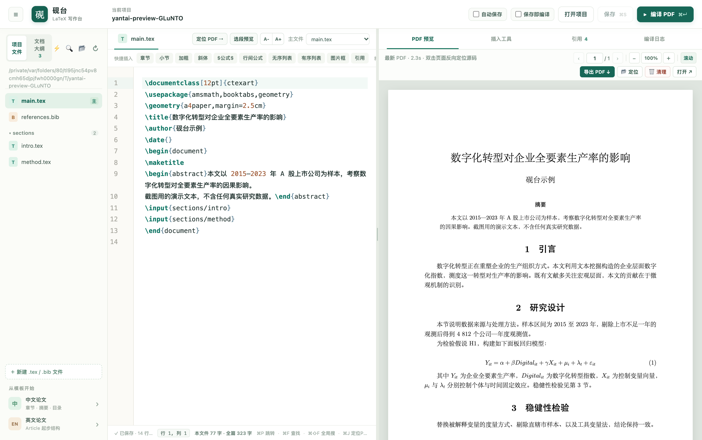

# 砚台 · LaTeX 写作台

在本机浏览器中编辑 LaTeX 项目、编译并预览 PDF。文件直接保存在你选择的文件夹，不需要账户。



## 启动

需要 macOS、Node.js 和 [Tectonic](https://tectonic-typesetting.github.io/book/latest/index.html)。当前电脑已安装 Tectonic。

### 方式一：一键脚本启动（推荐）

在 Finder 中直接双击 [`启动砚台.command`](./启动砚台.command)，或在终端运行：

```bash
/Users/xurry/Project/Latex_tools/start.sh
```

脚本会自动检查并安装依赖、在源码有更新时自动构建 `dist/`、启动本地服务并自动在浏览器打开 `http://127.0.0.1:3210`。若服务已在运行，则会直接唤起浏览器页面。

### 方式二：手动命令启动

```bash
cd /Users/xurry/Project/Latex_tools
npm install
npm start
```

浏览器打开 [http://127.0.0.1:3210](http://127.0.0.1:3210)。终端保持运行；按 `Ctrl+C` 关闭本地服务。首次编译新宏包时，Tectonic 可能联网下载支持文件。

### 停止服务

先保存正在编辑的文档，再任选一种方式停止：

- 在启动服务的终端窗口按 **Control+C**（不是 `⌘C`）。
- 在 Finder 中双击 [`停止砚台.command`](./停止砚台.command)，即使原来的启动窗口已找不到也能停止。
- 在终端运行 `/Users/xurry/Project/Latex_tools/stop.sh`。

关闭浏览器页面不会停止本地服务。重复双击启动脚本时，如果服务已在运行，新窗口只负责打开网页；要停止原服务，请用停止脚本。停止脚本会检查进程的工作目录和启动命令，只停止当前仓库的服务；服务未运行时会直接提示。

如果使用自定义端口，启动和停止使用相同的端口，例如 `PORT=3211 ./start.sh` 和 `PORT=3211 ./stop.sh`。

## 使用流程

1. 点击顶部“打开项目”（或直接点顶栏当前项目名），选择已有论文文件夹或输入绝对路径；首页与打开弹窗会列出**最近打开的项目**方便一键切换。服务重启后也会自动尝试恢复上次打开的项目。
2. 在左侧“项目文件”打开 `.tex`、`.bib`、`.sty` 或 `.cls` 文件（新建文件时支持直接输入 `sections/intro.tex` 自动创建子目录；文件较多时可按文件名过滤、折叠子文件夹，悬停 `.tex` 文件可一键**`设为主`**编译入口）；切换到“文档大纲”可在**“全篇大纲”**（自动递归串联 `\input` / `\include` 各章节文件）与**“当前文件”**之间切换，或直接按 **`⌘P`** 呼出快速跳转面板检索任意文件与章节标题。
3. 编辑时支持 `\cite{...}`、`\ref{...}`、`\input{...}`、`\includegraphics{...}`、`\\begin{...}` 及常用命令智能补全；支持 `⌘S` 保存（或开启顶部“自动保存”、“保存即编译”）、`⌘F` 中文查找/替换、点击底栏行列号跳行、`⌘/` 注释切换、`⌘\` 折叠/展开侧边栏、`⌘B` 加粗、`⌘I` 斜体、`⌘M` 行内公式、顶部 `A-`/`A+` 调节字号，按 `⌘↵` 编译全文，或选中公式/段落按 **`⌘L`**（或 **`⌘` + 双击行**）进行**选段极速预览**。长篇正文编译常要几十秒，编译期间按钮旁会出现 **`■ 取消编译`**，随时中止并立刻腾出编译队列（正在显示的 PDF 原样保留）。底栏实时显示本文件与全篇总字数；编译报错会在编辑器行内与文件树标出提示点，悬停可看中文排错建议，按 **`⌘⇧E`** 逐条跳到报错行。
4. **跨文件搜索与快速跳转**：按 `⌘⇧F` 或点击侧栏 🔍，在所有 `.tex` / `.bib` 等文件（含当前未保存缓冲）中查找关键词，支持区分大小写与正则表达式；按 `⌘P` 或点击侧栏 ⚡ 可按文件名或章节名秒级跳转。搜索跑在独立线程里并带硬超时，写歪的正则最多让这一次搜索超时，**不会把正在进行的编译一起卡住**。
5. **外部修改自动同步**：切回浏览器标签页时自动检查磁盘上的文件——没有未保存改动就直接载入最新版；有冲突则弹出选择条（继续编辑 / 重新加载 / 覆盖磁盘），不会静默丢内容。判断依据是**文件内容而不是修改时间**，所以项目在 iCloud / OneDrive 目录里、或同步盘只是换了下 inode 时，不会莫名重建编辑器、丢掉撤销记录。
6. **双向 SyncTeX 定位与连续滚动 PDF**：右侧 PDF 预览支持丝滑连续滚动、双指捏合缩放、页码直达与“适应页宽/整页”切换，重编译与缩放时保持原阅读位置。在编辑器中按 **`⌘J`**（或点工具栏 **`定位 PDF ⇢`**）可正向滚动到对应 PDF 页并高亮目标区域；**双击 PDF 页面任意位置**可通过 SyncTeX 精准反向跳转到对应 `.tex` 子文件与源码行。顶栏提供 **`导出 PDF ↓`**、**`📂 定位`**（在 Finder 中选中 PDF）和 **`🗑️ 清理`**（一键删除 `.latex-tools/build/` 缓存）。毕业论文这种几十上百页的大 PDF **按页分段取用**，不用先把整份下载完才出第一页；编译失败时预览**继续显示上一版成功的 PDF** 并标注“上一次生成的版本”，不会白屏，也不会把旧版悄悄说成新结果。
7. **插入工具**：提供分类数学符号库（常用 / 希腊字母 / 矩阵结构 / 关系箭头，支持包环境或仅插入内容）、支持**直接从 Excel / Numbers / CSV / Markdown 粘贴多行多列数据**的学术三线表（`booktabs`）生成器，以及图片缩略图预览与拖拽/粘贴自动存图。**同一张图反复粘贴不会重复存盘**（按图片内容识别，提示已复用，正文照常插入）；拖入非图片文件会被明确忽略，不会把文件路径当成正文文本插进光标处。
8. **文献与交叉引用**：“引用”页支持一键在 `.bib` 中创建期刊、会议、书籍、学位论文、预印本模板，读取 `.bib` 条目详情与 `.tex` 中的 `\label`（公式标签自动使用 `\eqref`），点击插入引用，点右侧 `↗` 直接跳回定义行。
9. 空文件夹可以使用通用中文或英文论文起步模板；工具不会覆盖已有同名文件。

## 当前范围

- 默认编译器是 Tectonic，适合常见 XeTeX / BibTeX 项目。它会把 PDF 和日志放到项目的 `.latex-tools/build/`，原始源码不受影响。同一时刻只跑一个编译任务；编译中可以取消，取消或失败都不会让下一次编译排队卡死。停掉服务时会顺带收掉它启动的 TeX 进程组，不留孤儿进程。
- 不提供学校专属毕业论文格式。已有模板可直接打开；使用 `biber`、`minted` 或特定 TeX Live 编译脚本的项目，可能需要后续支持自定义编译链。
- 为保护本地文件，服务只监听 `127.0.0.1` 并校验请求来源（Host / Origin / `Sec-Fetch-Site`），**其它网页读不到你打开的项目里的文件**；网页只能访问已打开的项目目录，符号链接也不能越界。保存时若检测到其他程序改过文件，会阻止覆盖。
- 为了响应速度，文件树最多列出 800 个文件（超出会明确提示，不是悄悄少显示）；跨文件搜索一次最多扫描 200 个文件、返回 300 条结果。**没扫完一定会告诉你没扫完**：超时写「搜索超时，没有扫完，还不清楚有没有匹配」，只扫了前 200 个文件写「只扫完前 N 个文件，其中没有匹配」，只有真正扫完才说「没有找到匹配内容」。

详细范围见 [REQUIREMENTS.md](./REQUIREMENTS.md)。

接力开发约定见 [Agent.md](./Agent.md)；常见 agent 会从 [AGENTS.md](./AGENTS.md) 找到它。
